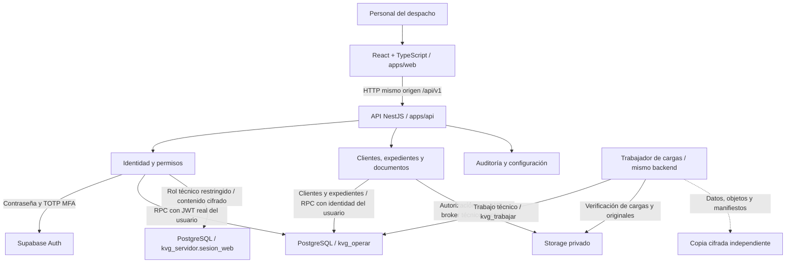

# Arquitectura del sistema

## Decisión de referencia

Se adopta el monolito modular descrito en las secciones 15 y 16 de Elaboración
v2.0, incluida dentro de `RUP Fase de Construcción.pdf`. El modelo lógico v1.1
y el SQL PostgreSQL suministrado desarrollan esa propuesta. El documento de
Elaboración independiente conserva la alternativa histórica PHP/MySQL.

Esta decisión organiza el código para un equipo pequeño, con un lenguaje compartido
entre frontend y backend y límites internos por función. No se separa cada módulo
como un servicio desplegable. El procesamiento largo utilizará el mismo proyecto
con otro punto de entrada y otro proceso.

## Componentes

React y la API incluyen inicio/cierre de sesión con Supabase Auth, MFA TOTP y
sesión operativa KVG. La persistencia de la cookie del servidor está separada de
las tablas de negocio. Las conexiones discontinuas representan trabajo pendiente:
recuperación operativa completa y respaldos programados. Documentos, transferencia
privada y trabajador de cargas están implementados según [documents.md](documents.md). Los módulos de
clientes y expedientes ya implementan el recorrido mínimo del paso 3A. La
verificación de identidad en desarrollo no acredita todavía el prototipo completo.

## Límites del código

`apps/web` consume HTTP y presenta resultados. Las funcionalidades futuras irán en
`src/features/<funcionalidad>`, mientras `src/app` compone la aplicación y
`src/shared` contiene utilidades realmente compartidas. Por petición del usuario,
`src/app/styles.css` adapta el diseño HTML entregado por el usuario: menú lateral,
tablas, formularios en columnas y secciones de detalle. `App` compone el acceso y
la navegación en memoria; `Sidebar` muestra destinos según capacidades vigentes.
Los componentes de negocio permanecen en `features`; los tipos de navegación
compartidos están en `shared/navigation.ts`. Se usa CSS sin dependencias nuevas,
con foco visible, salto al contenido y adaptación móvil. El logo se sirve desde
`public/kvg-logo.jpg`; no se cargan fuentes ni scripts de terceros. Véase
[el alcance de la adaptación visual](interface.md).

`apps/api/src/modules` delimita identidad, clientes, expedientes, documentos,
auditoría, configuración y operaciones. Las capas se crean cuando tienen código:

| Capa             | Responsabilidad                                        | Dependencias                        |
| ---------------- | ------------------------------------------------------ | ----------------------------------- |
| `domain`         | Reglas y tipos de negocio propios                      | Ninguna del framework o proveedor   |
| `application`    | Casos de uso y puertos de entrada/salida               | Dominio                             |
| `infrastructure` | Adaptadores Supabase RPC, objetos y servicios técnicos | Contratos de aplicación y proveedor |
| `presentation`   | Controladores HTTP y DTO; validación de entrada        | Aplicación y NestJS                 |

El módulo Nest conecta esas piezas. Los controladores no contienen consultas SQL
ni reglas de autorización dispersas. Las transacciones y restricciones del modelo
físico siguen siendo responsables de la integridad; no se duplican en entidades
inventadas ni se reemplazan por escrituras libres desde la interfaz.

`packages/contracts` comparte únicamente tipos públicos HTTP mediante `import type`.
No comparte entidades de base de datos, secretos, clientes Supabase ni servicios Nest.
Los DTO y la validación del servidor se implementan junto al caso de uso; los tipos
TypeScript por sí solos no validan datos recibidos por HTTP.

## Acceso a datos y confianza

La baseline restringe las operaciones ordinarias a `public.kvg_operar` y las
técnicas a `public.kvg_trabajar`. La fábrica del backend crea un cliente ordinario
por llamada con el token obtenido de la sesión validada del servidor.
La API elige operaciones concretas a partir de endpoints definidos; no ofrece
un puente RPC libre que acepte operaciones arbitrarias del navegador.

`src/infrastructure/supabase` contiene los adaptadores transversales de conexión y
RPC. `SupabaseModule` exporta `KvgRpcService`; cada módulo funcional que lo necesite
importará ese módulo. No se mantienen sesiones globales mutables ni se reutiliza un
cliente autenticado entre usuarios. El adaptador comprueba el envoltorio de éxito
o rechazo y conserva los resultados como `unknown` para validarlos en cada caso de
uso. Los errores de transporte y del SQL se traducen sin exponer detalles internos.

La configuración Supabase es opcional para health y exige ambas variables cuando
se utiliza. El diagnóstico CLI usa solo GET y se complementa con la inspección SQL
de metadatos. No llama `kvg_operar`: la función puede registrar actividad y auditoría.
El procedimiento está en [supabase-setup.md](supabase-setup.md).

El módulo `identity` conserva los tokens Auth únicamente en el servidor y expone al
navegador una cookie opaca `HttpOnly`, `SameSite=Lax`, con `Secure` y prefijo
`__Host-` en producción. El segundo factor TOTP es obligatorio para abrir la sesión
operativa: el SQL exige `aal2`. Los identificadores Auth y usuario KVG se mantienen
separados. La interfaz presenta correo/contraseña, inscripción/verificación MFA y
cierre/actualización mediante controles HTML con estilos mínimos.

`ServerSessions` serializa las operaciones que leen o renuevan tokens mediante
bloqueos PostgreSQL por SID y recarga la sesión antes de cambiarlos. Su almacén usa
el rol `kvg_session_store`, que solo tiene acceso a `kvg_servidor.sesion_web`; el
SID se guarda como SHA-256 y el contenido se cifra con AES-256-GCM y clave externa.
Una respuesta antigua solo puede tocar la expiración y no reemplaza tokens nuevos.
Las marcas de revocación impiden reactivar una cookie cerrada por una escritura tardía.
No se usa `MemoryStore` en la aplicación: aparece únicamente en pruebas locales.

El servidor comprueba identidad Auth y estado de la sesión operativa mediante
`sesion.consultar` en cada petición privada. El guard global deniega por defecto;
`@RequirePermission` comprueba permiso y contexto vigentes y cada RPC sigue
comprobando el recurso concreto. `@Authenticated` se reserva a información de la
propia sesión. Las mutaciones de acceso requieren origen exacto y token CSRF;
login/MFA/renovación tienen límites de intentos por IP y cuenta/sesión por instancia.
Las altas de clientes y expedientes incorporan la misma protección CSRF; las
futuras mutaciones deben conservarla.

La sesión previa a MFA vence en diez minutos. SQL valida la duración absoluta
de cada sesión operativa y su inactividad. Los parámetros admiten 1–8 horas y
5–30 minutos respectivamente, según los límites de PT02. La renovación del proveedor no amplía el límite absoluto. El cierre intenta
revocar la sesión KVG y Auth y destruye la cookie local incluso si el proveedor falla.
La auditoría SQL de sesiones se complementa con eventos fijos del backend, sin
contraseñas, códigos, secretos TOTP ni tokens. Los módulos de bitácora y
configuración usan RPC con la identidad del usuario y validan el permiso global
en la API y en SQL. La proyección, la concurrencia por revisión y el historial
se describen en [Bitácora y configuración](audit-and-configuration.md).

Los roles funcionales se combinan con permisos y alcance del expediente. La cuenta
administradora técnica no obtiene lectura jurídica automáticamente. Las claves
privilegiadas se reservan al proceso que las necesita; nunca se incluyen en variables
`VITE_*`, contratos compartidos ni respuestas del frontend.

El esquema trae RLS y restricciones de privilegios. El proceso HTTP usa conexión SQL
directa solo con el rol restringido del almacén de sesiones. `DATABASE_URL` se reserva a herramientas de preparación/verificación y ensayo
de desarrollo. `SUPABASE_SECRET_KEY` se usa además en el broker privado de archivos
de la API y el trabajador, exclusivamente para RPC técnico y Storage tras
autorización ordinaria; no sustituyen las comprobaciones de identidad, permiso
y alcance del negocio. El acceso técnico a Storage queda limitado por los
endpoints y autorizaciones del broker, según el contrato suministrado. El contrato completo y
el procedimiento de instalación están en [database/README.md](../database/README.md).

## Base ejecutable y configuración

La API tiene prefijo `/api/v1`, validación global de DTO, cabeceras HTTP mediante
Helmet y un formato común de error que oculta fallos internos. La configuración
valida el entorno y el puerto antes de abrir el servidor. Las aplicaciones escuchan
en loopback de forma predeterminada para desarrollo.

`GET /api/v1/health` es público y solo informa de la salud del proceso. El contrato
de `/api/v1/auth` y los pasos para probarlo están en [identity.md](identity.md).
Las rutas privadas de clientes y expedientes usan el guard y los puertos RPC por
identidad; las altas incorporan CSRF y el SQL comprueba el alcance concreto. El
contrato y sus límites están en [clients-and-cases.md](clients-and-cases.md).

El proxy Vite permite consumir `/api` desde el mismo origen durante desarrollo.
En producción habrá que configurar el servicio o proxy que entregue los archivos
estáticos de la web y reenvíe `/api` a Nest bajo HTTPS. La preparación de 3C incorpora imágenes y Compose con Caddy, secretos
montados y un ensayo HTTPS local. No publica servicios en un alojamiento remoto.
Véase [staging-deployment.md](staging-deployment.md). La configuración de cookies y persistencia
del servidor está implementada; su validación bajo HTTPS y el endurecimiento del
entorno desplegado siguen pendientes. El frontend no necesita CORS entre orígenes.

Las migraciones y la preparación de identidades son comandos explícitos y no se
ejecutan al arrancar Nest. La configuración de sesiones requiere URL SQL de rol
restringido, secreto HMAC y clave de cifrado juntos. Desarrollo permite arrancar
solo health sin ellos; producción rechaza su ausencia. Los secretos quedan fuera
del repositorio. La provisión ficticia y las pruebas remotas están separadas de CI.

Se usa npm workspaces con versiones directas exactas y `package-lock.json` para
instalación reproducible. `.nvmrc`, `.node-version` y CI seleccionan Node 24 LTS;
el motor permite también Node 26 en desarrollo. TypeScript se mantiene en 5.9.3
como versión compatible con la compilación de decoradores de Nest.

## Procesamiento y consistencia

El trabajador documental procesa cargas y recuperaciones persistentes con leases, reintentos y
backoff del SQL. El sondeo local no sustituye la cola persistente y no reclama
trabajos de identidad, respaldo o restauración. La conciliación automática de
objetos huérfanos y recepción abandonada sigue pendiente.

La publicación exige cuarentena, verificación estructural real, ClamAV y
hash confiable. Una verificación técnica apta no equivale a validación jurídica.
Las versiones conservan objetos distintos e historial; los retiros son recuperables.

PostgreSQL y Storage no comparten transacción. La carga coordina estados, objetos inmutables y reintentos; faltan los barridos
automáticos y la gestión operativa completa. Los respaldos deberán incluir datos, objetos y manifiestos, con
restauración aislada y aplicación de las restricciones vigentes. Las propuestas
pendientes PT01–PT08 están registradas en [requirements.md](requirements.md).

## Verificación

`npm run check` comprueba formato, tipos, compilación, pruebas HTTP/almacén del
backend y cliente HTTP de React. Son independientes de Supabase y cubren identidad,
MFA simulado, CSRF/origen, límites de intentos, permisos, revocación y renovación
concurrente. El almacén tiene pruebas de cifrado, integridad y escrituras tardías.

`npm run test:identity:schema` comprueba el contrato SQL y denegación sin identidad
dentro de una transacción revertida. `npm run test:identity:live` ejercita Auth,
TOTP, RPC, persistencia cifrada y revocación reales contra el proyecto de desarrollo
con cuentas ficticias. Estas pruebas no se ejecutan en CI ni usan datos reales.
El incremento de clientes/expedientes añade comprobaciones de SQL y RPC reales y
un recorrido de Chromium local, incluida la vista móvil. La evidencia y los límites
están en [clients-and-cases.md](clients-and-cases.md), [identity.md](identity.md) y
[supabase-verification.md](supabase-verification.md). Producción sigue pendiente.

Antes de considerar validada la arquitectura completa se necesita demostrar con
datos ficticios: identidad real, expediente accesible, carga privada segura, consulta
autorizada, denegación para otra identidad y recuperación verificable. Los escenarios
de datos pendientes están en [database/tests/README.md](../database/tests/README.md).

Referencias técnicas consultadas para esta preparación:

- [NestJS: primeros pasos](https://docs.nestjs.com/first-steps).
- [Vite: guía de inicio](https://vite.dev/guide/).
- [Node.js: versiones y soporte LTS](https://nodejs.org/en/about/previous-releases).
- [Supabase: claves de API y privilegios](https://supabase.com/docs/guides/api/api-keys).

## Recorrido mínimo de clientes y expedientes

`clients` y `cases` separan tipos de dominio, puertos/casos de aplicación,
adaptadores RPC y controladores/DTO. Los adaptadores seleccionan campos HTTP y
validan las respuestas `unknown`; no devuelven filas internas. La web comparte el
transporte de cookie/CSRF y coordina formularios separados de registro/apertura,
listados y detalles dentro de `features/records`.

La API requiere un UUID de solicitud en cada alta. PostgreSQL confirma el recurso
y su clave de reintento en una sola transacción; serializa solicitudes repetidas y
revalida alcance antes de consultar el resultado. La tabla privada guarda hash e
identificador, sin respuestas personales. Las migraciones 003/004 amplían el RPC
con esta garantía y los nombres de responsables ya autorizados; la baseline queda
intacta y no se amplían permisos de tablas.

La preparación ficticia de Secretaría usa la identidad MFA del administrador para
los RPC de usuarios/roles y una credencial técnica únicamente para Auth Admin y la
conciliación de identidad por `kvg_trabajar`. No sustituye la identidad ordinaria en
operaciones de clientes/expedientes. No hay un trabajador general ejecutándose.

## Paquete de despliegue preparado (3C)

Las imágenes mantienen React compilado y NestJS sin cambiar módulos ni contratos.
API y trabajador usan el mismo artefacto Node con entradas distintas y usuario sin
root. `validateWorkerEnvironment` valida solo sus dependencias técnicas: no recibe
claves de sesión ni acceso SQL de propietario. `runtime-secrets` admite archivos
montados para la API y el trabajador y rechaza valores simultáneos en entorno/archivo.
Caddy es el único punto de entrada y conserva el mismo origen HTTPS; los secretos
no se suministran durante el build. La prueba TLS local usa infraestructura efímera,
sin autenticación Supabase ni datos de desarrollo. El despliegue remoto y la
recuperación de un Supabase separado permanecen abiertos.

## Ajuste operativo sin servicios nuevos

Por decisión del usuario del 10 de noviembre de 2026 se utiliza solo el Supabase
actual de desarrollo con datos ficticios. El despliegue separado y la operación
del antivirus se posponen; el monolito y los límites de confianza se conservan.
`DocumentUploadPolicy`, inyectada en la aplicación, impide crear/recibir cargas
cuando `DOCUMENT_UPLOAD_MODE=paused` (valor predeterminado). El controlador la
consulta antes de consumir el flujo, y el cliente presenta la disponibilidad sin
sustituir guards ni permisos. El trabajador sale sin reclamar trabajos en ese modo.
El modo `verified` conserva ClamAV, comprobación estructural y hash obligatorios.
Para la demo, `beta` omite solo ClamAV, con activación explícita en SQL y marca
`BETA_SIN_ANTIMALWARE` por original. [Modo beta](document-beta.md).
No se incorpora otro proveedor, API comercial o clave nueva. Se conserva la
preparación de staging para uso futuro. Véase [security-current-scope.md](security-current-scope.md).

La asignación y reasignación usan operaciones RPC fijas bajo identidad de usuario.
El administrador recibe solo folio, estado y equipo vigente para un relevo. El
listado del abogado filtra por asignaciones y concesiones vigentes antes de
paginar. El cambio de principal, cierre de accesos, posible continuidad como
colaborador y auditoría se ejecutan en una misma transacción de PostgreSQL.

Las opciones de cambio de estado y su validación consultan la misma matriz SQL.
El cambio conserva motivo y revisión en el historial. Los avances usan una
solicitud idempotente y se agregan con autor y fecha de servidor. La proyección
de referencias documentales aplica alcance a cada versión en cada consulta.

La búsqueda documental aplica permisos en PostgreSQL antes de ordenar y paginar.
Clasificar o trasladar usa el mismo RPC ordinario con revisión y alcance vigente.
Los cambios de metadatos y sus historiales se confirman en una sola transacción,
con acceso posterior según el expediente asociado.

CU014 reutiliza la recepción privada y el trabajador de CU008 para publicar
un original nuevo. PostgreSQL bloquea el documento durante la publicación,
comprueba la revisión reservada y vuelve a evaluar las capacidades y el alcance
del solicitante. La revisión obsoleta termina el trabajo sin actualizar la
versión vigente. El nombre y su motivo quedan en un historial privado de
metadatos. El historial de versiones proyecta integridad y revisiones jurídicas
con el JWT del usuario. El broker autoriza y comprueba cada descarga por versión.

CU016 y CU026 usan el RPC ordinario y bloquean documento y versión al escribir.
La matriz SQL determina las transiciones que se muestran y las que se pueden
confirmar con la autorización actual. Las observaciones y sus correcciones son
inmutables y permanecen en la versión revisada aunque cambie la vigente. La
bitácora referencia las operaciones sin copiar las observaciones jurídicas.

CU027 registra el retiro y su restricción en una transacción. El broker
rechaza autorizaciones de descarga anteriores al retiro, incluso después
de recuperar el documento. CU028 reserva con el JWT administrativo y
encola una tarea separada. El trabajador verifica existencia, tamaño,
SHA-256 y condición técnica de cada original. PostgreSQL coteja la evidencia,
los metadatos de Storage y la autorización vigente antes de restablecer
disponibilidad. La recuperación conserva las asignaciones y concesiones
actuales como fuente de autorización.

CU018/CU019 reutilizan la sesión operativa AAL2 y el RPC con JWT del usuario
para reservar y consultar perfiles, editar cuentas, administrar roles y
autorizar accesos. El adaptador técnico usa la clave de servidor solo para
enviar invitaciones y bloquear al usuario correspondiente en Auth. La
aceptación usa el token del proveedor en una sesión cifrada breve. La
activación del perfil se confirma junto con la primera sesión AAL2 y el
trabajo de identidad. Las mutaciones serializan cambios de seguridad,
comprueban revisión, protegen el relevo de principales y mantienen una
cuenta capaz de administrar usuarios y permisos.
