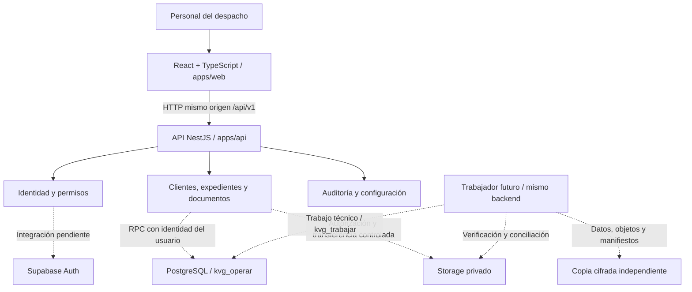

# Arquitectura inicial

## Decisión de referencia

Se adopta el monolito modular descrito en las secciones 15 y 16 de Elaboración
v2.0, incluida dentro de `RUP Fase de Construcción.pdf`. El modelo lógico v1.1
y el SQL PostgreSQL suministrado desarrollan esa propuesta. El documento de
Elaboración independiente conserva la alternativa histórica PHP/MySQL.

Esta decisión organiza el código para un equipo pequeño, con un lenguaje compartido
entre frontend y backend y límites internos por función. No se separa cada módulo
como un servicio desplegable. El procesamiento largo utilizará el mismo proyecto
con otro punto de entrada y otro proceso.

## Componentes

Las conexiones a Supabase, Storage, trabajador y copia independiente representan
la arquitectura prevista. Esta entrega ejecuta únicamente React, la API y su
comprobación de salud; no implementa todavía esos procesos externos.

## Límites del código

`apps/web` consume HTTP y presenta resultados. Las funcionalidades futuras irán en
`src/features/<funcionalidad>`, mientras `src/app` compone la aplicación y
`src/shared` contiene utilidades realmente compartidas. No se añaden componentes
visuales, CSS ni animaciones durante esta etapa.

`apps/api/src/modules` delimita identidad, clientes, expedientes, documentos,
auditoría, configuración y operaciones. Las capas se crean cuando tienen código:

| Capa             | Responsabilidad                                        | Dependencias                        |
| ---------------- | ------------------------------------------------------ | ----------------------------------- |
| `domain`         | Reglas y tipos de negocio propios                      | Ninguna del framework o proveedor   |
| `application`    | Casos de uso y puertos de entrada/salida               | Dominio                             |
| `infrastructure` | Adaptadores Supabase RPC, objetos y servicios técnicos | Contratos de aplicación y proveedor |
| `presentation`   | Controladores HTTP y DTO; validación de entrada        | Aplicación y NestJS                 |

El módulo Nest conecta esas piezas. Los controladores no contienen consultas SQL
ni reglas de autorización dispersas. Las transacciones y restricciones del modelo
físico siguen siendo responsables de la integridad; no se duplican en entidades
inventadas ni se reemplazan por escrituras libres desde la interfaz.

`packages/contracts` comparte únicamente tipos públicos HTTP mediante `import type`.
No comparte entidades de base de datos, secretos, clientes Supabase ni servicios Nest.
Los DTO y la validación del servidor se implementan junto al caso de uso; los tipos
TypeScript por sí solos no validan datos recibidos por HTTP.

## Acceso a datos y confianza

La baseline restringe las operaciones ordinarias a `public.kvg_operar` y las
técnicas a `public.kvg_trabajar`. El backend futuro creará el cliente ordinario por
petición, usando identidad real del usuario conservada en su sesión del servidor.
La API elegirá operaciones concretas a partir de endpoints definidos; no ofrecerá
un puente RPC libre que acepte operaciones arbitrarias del navegador.

Las cookies de sesión protegidas, MFA, renovación, revocación, CSRF y comprobación
del alcance todavía deben implementarse. El SQL exige `aal2` y sesión operativa KVG;
un inicio de sesión Auth de primer factor no completa esa integración.

Los roles funcionales se combinan con permisos y alcance del expediente. La cuenta
administradora técnica no obtiene lectura jurídica automáticamente. Las claves
privilegiadas se reservan al proceso que las necesita; nunca se incluyen en variables
`VITE_*`, contratos compartidos ni respuestas del frontend.

El esquema trae RLS y restricciones de privilegios. No se configura conexión directa
como propietario ni un ORM para evitar esas restricciones. El contrato completo y
el procedimiento de instalación están en [database/README.md](../database/README.md).

## Base ejecutable y configuración

La API tiene prefijo `/api/v1`, validación global de DTO, cabeceras HTTP mediante
Helmet y un formato común de error que oculta fallos internos. La configuración
valida el entorno y el puerto antes de abrir el servidor. Las aplicaciones escuchan
en loopback de forma predeterminada para desarrollo.

`GET /api/v1/health` es público y solo informa de la salud del proceso. Los módulos
de negocio no tienen rutas todavía. Antes de añadirlas deberán incorporarse las
sesiones y la autorización con denegación por defecto.

El proxy Vite permite consumir `/api` desde el mismo origen durante desarrollo.
En producción habrá que configurar el servicio o proxy que entregue los archivos
estáticos de la web y reenvíe `/api` a Nest bajo HTTPS. Esta preparación no despliega
servicios ni configura CORS, cookies o persistencia de sesiones de producción.

Se usa npm workspaces con versiones directas exactas y `package-lock.json` para
instalación reproducible. `.nvmrc`, `.node-version` y CI seleccionan Node 24 LTS;
el motor permite también Node 26 en desarrollo. TypeScript se mantiene en 5.9.3
como versión compatible con la compilación de decoradores de Nest.

## Procesamiento y consistencia pendientes

El trabajador futuro procesará trabajos persistentes con arrendamientos, reintentos
y conciliación. No se añade una segunda cola ni un temporizador en memoria mientras
el contrato operativo del SQL no se haya integrado y probado.

La publicación de un documento exigirá cuarentena, verificación real, antimalware y
hash confiable. Una verificación técnica apta no equivale a validación jurídica.
Las versiones conservan objetos distintos e historial; los retiros son recuperables.

PostgreSQL y Storage no comparten transacción. La coordinación requerirá estados y
compensaciones. Los respaldos deberán incluir datos, objetos y manifiestos, con
restauración aislada y aplicación de las restricciones vigentes. Las propuestas
pendientes PT01–PT08 están registradas en [requirements.md](requirements.md).

## Verificación

`npm run check` comprueba formato, tipos, compilación y pruebas HTTP de la base.
Las pruebas verifican el contrato consumido por React, cabeceras, errores de rutas
y rechazo de configuración inválida. Son independientes de Supabase.

En la preparación del 27 de octubre de 2026 se verificaron `npm ci` con Node
24.22.1 y `npm run check` con Node 24.22.1 y 26.11.1: tipos y compilación correctos,
tres pruebas aprobadas. También se comprobó por HTTP el arranque de web, API y
proxy local. No se ejecutaron pruebas en navegador ni integración con Supabase.

Antes de considerar validada la arquitectura completa se necesita demostrar con
datos ficticios: identidad real, expediente accesible, carga privada segura, consulta
autorizada, denegación para otra identidad y recuperación verificable. Los escenarios
de datos pendientes están en [database/tests/README.md](../database/tests/README.md).

Referencias técnicas consultadas para esta preparación:

- [NestJS: primeros pasos](https://docs.nestjs.com/first-steps).
- [Vite: guía de inicio](https://vite.dev/guide/).
- [Node.js: versiones y soporte LTS](https://nodejs.org/en/about/previous-releases).
- [Supabase: claves de API y privilegios](https://supabase.com/docs/guides/api/api-keys).
