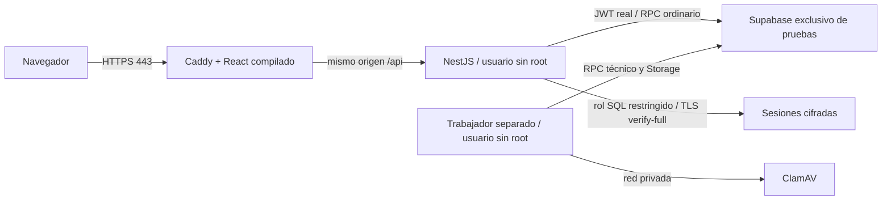

# Paso 3C: preparar y verificar el despliegue de prueba

Estado al 10 de noviembre de 2026: **paquete de despliegue construido y HTTPS local
verificado; publicación remota pendiente**. No se eligió ni contrató un proveedor,
no se publicó una URL y no se reutilizó el Supabase de desarrollo como staging.
El diseño KVG, los CU y los contratos de negocio permanecen iguales.

**Actualización de alcance:** el usuario pospone antivirus operativo y otro
Supabase. Este paquete se conserva como preparación futura; no es el siguiente
paso obligatorio ni exige crear cuentas ahora. El trabajo continúa localmente con
el Supabase actual, cargas pausadas y clientes 4A. No se ha convertido desarrollo
en staging ni producción. Véase [security-current-scope.md](security-current-scope.md).

Las instrucciones siguientes solo aplican **al retomar el despliegue separado**;
el preflight mantiene esa separación para no etiquetar el mismo entorno como otro.
La propuesta Docker es portable y no fija proveedor, presupuesto ni PT06/PT08.

## Arquitectura del paquete



`infrastructure/staging/Dockerfile` construye dos imágenes desde el mismo lockfile:
API/trabajador sobre Node 24 Debian y web sobre Caddy. Las bases se fijan por digest.
El build instala/compila; el arranque no instala paquetes, migra ni inicializa datos.
La imagen final de API usa el usuario `node`, sin código de preparación ni SQL de
propietario. `.dockerignore` excluye `.env`, `.local`, Git, respaldos y certificados.
Las imágenes pueden etiquetarse por commit al publicar una entrega.

`compose.yml` inicia web y API por defecto, con cargas pausadas. Trabajador y
ClamAV requieren el perfil explícito `document-verification`. Para retomar el
recorrido completo, configurar `DOCUMENT_UPLOAD_MODE=verified` en los ajustes y
añadir `--profile document-verification` a Compose. El modo `verified` sigue
exigiendo análisis real; no es una opción para omitirlo. Solo Caddy publica puertos;
API, PostgreSQL remoto y ClamAV no reciben una publicación directa del host. El
proxy establece los encabezados reenviados y la API confía en un único salto.
No colocar otro proxy/CDN delante sin revisar otra vez esa cadena de confianza.
Caddy no habilita logs de acceso y no almacena cookies, cuerpos ni URL de descarga
en un registro general. Los logs de contenedores tienen rotación acotada.

El trabajador recibe solo la URL Supabase, su clave técnica y la conexión privada
a ClamAV. Ya puede arrancar con variables/archivos montados sin necesitar `.env`,
claves de cookies ni conexión SQL de sesiones. Su validación se separó de la API.
API y trabajador usan filesystem de solo lectura, directorio temporal acotado,
sin capacidades adicionales y sin escalamiento de privilegios. Se conservan firmas
de ClamAV y certificados de Caddy en volúmenes independientes.

Caddy sirve web y `/api` en el mismo origen y gestiona certificados para el dominio
real. Conserva límites de cuerpo, CSP y encabezados de seguridad. La sesión sigue
usando `__Host-kvg.sid`, `Secure`, `HttpOnly` y `SameSite=Lax`; los secretos de firma,
cifrado y SQL se leen desde `/run/secrets`. No se incluye Supabase ni sus claves
en variables `VITE_*`, imágenes, argumentos de build o respuestas del frontend.

## Preparar los recursos pendientes cuando se retome 3C

1. Identificar servidor, dominio, presupuesto y responsable de la cuenta. El host
   necesita recursos para ClamAV (límite configurado de 2 GiB), trabajador, API y
   sistema operativo. Los límites de Compose son provisionales para pruebas;
   medir memoria/CPU antes de declarar capacidad de producción.
2. Preparar un **nuevo** Supabase de pruebas: Auth, PostgreSQL y Storage separados.
   Aprovisionar explícitamente la baseline y las seis migraciones, conservar
   checksums/ledger y verificar SQL antes del arranque de la aplicación. El proyecto
   de desarrollo existente no se reinstala ni se modifica por estos comandos.
3. Crear las identidades ficticias y perfiles KVG de ese proyecto con el contrato
   ordinario/técnico correspondiente; configurar MFA y desactivar registro público.
   Guardar su fixture aparte con `environment: "staging"`, `projectReference` y
   `accounts` (roles `SECRETARIA`, `ABOGADO`, `ADMINISTRADOR`; correos ficticios
   `@example.com`, `password`, `factorId`, `totpSecret`). No copiar las claves,
   sesiones ni la fixture del proyecto de desarrollo. Este incremento no ejecutó
   un bootstrap remoto ni inventó cuentas de staging.
4. Aprovisionar el rol `kvg_session_store` de ese proyecto y su contraseña privada.
   Usar Session pooler 5432 o conexión directa accesible, TLS `verify-full` y CA
   válida. Dentro del contenedor su URI debe referenciar
   `sslrootcert=/run/secrets/session_database_ca`. El proceso ordinario no recibe
   `DATABASE_URL` de propietario.
5. Guardar claves de firma y cifrado **nuevas para staging** y el resto de secretos
   fuera del repositorio, en un directorio del servidor. Permitir lectura al UID/GID
   1000 de la API: por ejemplo archivos `0600` propiedad del UID 1000 o `0440` con
   grupo 1000; directorio sin acceso para otros usuarios. La CA es pública. No
   imprimir claves ni incluirlas en comandos, imágenes, registros o conversaciones.

Archivos privados necesarios, sin valores de ejemplo reales:

| Nombre                   | Contenido                                           |
| ------------------------ | --------------------------------------------------- |
| `supabase_secret`        | Clave técnica secret del proyecto de pruebas        |
| `session_database_url`   | URI del rol restringido de ese proyecto             |
| `session_database_ca`    | CA pública PEM de PostgreSQL                        |
| `session_secret`         | Clave aleatoria de firma con al menos 32 caracteres |
| `session_encryption_key` | 32 bytes aleatorios codificados en base64           |

`infrastructure/staging/.env.example` contiene únicamente ajustes y nombres de
imágenes. Copiarlo fuera del repositorio y sustituir dominio, referencias, clave
publishable y ruta privada. `DEVELOPMENT_SUPABASE_URL` permite comprobar que ambos
proyectos son distintos; si existe `.env` local, también se compara con esa referencia.
El preflight rechaza reutilización de desarrollo, URI de propietario, otro proyecto,
pooler 6543, TLS débil, credenciales dentro de settings y archivos privados abiertos.
Esta validación estática **no** comprueba DNS, privilegios remotos ni que las claves
pertenezcan al proyecto: eso requiere verificar el entorno real.

## Construir y arrancar cuando el destino esté disponible

Desde la raíz del checkout de la entrega revisada:

```sh
npm ci
npm run check
npm run build:staging
npm run preflight:staging -- /srv/kvg-staging/settings.env
```

El constructor usa Buildx si está instalado y admite el constructor clásico del
Docker disponible en este equipo. No publica imágenes en un registro. Para otro
servidor, construir en él o transferir las imágenes mediante un registro o archivo
controlado; documentar el identificador/digest de la entrega que realmente se usa.
Los nombres `API_IMAGE`/`WEB_IMAGE` del constructor deben coincidir con settings.

En el servidor, después de configurar DNS, firewall 80/443 y custodia de secretos,
establecer explícitamente `STAGING_BIND_IP=0.0.0.0` en los ajustes privados. La
plantilla escucha en loopback por defecto para evitar una publicación accidental.

```sh
npm run preflight:staging -- /srv/kvg-staging/settings.env
docker compose --env-file /srv/kvg-staging/settings.env -p kvg-staging -f infrastructure/staging/compose.yml up -d
docker compose --env-file /srv/kvg-staging/settings.env -p kvg-staging -f infrastructure/staging/compose.yml ps
```

Mantener este servidor y sus volúmenes separados de desarrollo/producción. No usar
`down -v` como forma de actualizar. Para retomar el recorrido documental completo,
establecer `DOCUMENT_UPLOAD_MODE=verified` en settings y ejecutar el mismo comando
`up -d` con `--profile document-verification` antes de `up`. Verificar el estado de ClamAV y la vigencia de
sus firmas: si están viejas o el motor falla, el trabajador mantiene el bloqueo.
La salud de API es liveness del proceso, no una prueba de identidad/Storage/listo
para aceptar negocio. El cierre operativo de respaldos y monitorización sigue en
las etapas 6 y 8.

## Verificación preparada

`npm run test:staging:https` construye un ensayo temporal con las imágenes locales:
PostgreSQL efímero con TLS y el rol restringido real, API en modo producción y
Caddy con certificado local. Usa exclusivamente loopback y claves ficticias de
ensayo. Verifica CA sin desactivar TLS, web/API, cookie segura, CSRF/origen,
persistencia cifrada y ausencia de publicación directa de API. Elimina sus propios
contenedores, volúmenes anónimos, red y archivos temporales; no toca los SQL Server del usuario ni su
Supabase de desarrollo. La evidencia ignorada por Git se escribe en
`apps/api/.local/staging-https-verification.json`.

La verificación histórica del paquete inicial pasó 18 comprobaciones HTTPS. `npm run check` pasó formato,
tipos, compilación y 74 pruebas locales (58 API y 16 cliente HTTP), incluidas las
pruebas nuevas de secretos montados, trabajador mínimo y preflight. Las dos
imágenes se construyeron correctamente y la configuración Compose se validó.
La acción manual `.github/workflows/staging-images.yml` prepara la repetición en
CI sin publicar ni recibir credenciales; no se ha ejecutado esa acción remota.

Este ensayo **no autentica un usuario en Supabase**, no ejecuta un análisis de carga
remoto, no es una prueba de navegador completa y no constituye una publicación.
El certificado local se confía únicamente durante esa prueba; no se instala una
CA de desarrollo en el equipo o el navegador del usuario.

Para el destino remoto, está preparado el verificador explícito:

```sh
npm run verify:staging:remote -- /srv/kvg-staging/settings.env /srv/kvg-staging/test-accounts.json /srv/kvg-staging/evidence.json
```

Usa HTTPS con validación normal del certificado, fixture exclusiva de staging,
contraseña/MFA reales, cookie segura, alta de cliente/expediente ficticios, carga,
trabajador, hash y descarga permitida/denegada para otras identidades, cierre y
rechazo de la cookie cerrada. Deja datos ficticios/auditoría para revisión; no borra
registros, no envía correos ni ejecuta migraciones. Su resultado se escribe fuera
del repositorio. El verificador no usa ni solicita la conexión SQL de propietario.
No se ha ejecutado contra un host remoto porque todavía no se proporcionó.

## Pendiente para cerrar 3C y RUP 16.6

- URL de pruebas funcionando con certificado válido y proyecto Supabase separado.
- Evidencia del recorrido remoto y del uso por navegador, con permisos y alcance
  reales, privacidad de cuarentena, fallos del analizador y revocación.
- Ampliar la copia/restauración en el entorno separado: datos, originales,
  manifiesto, identidad/proveedor y restricciones actuales antes de habilitar
  acceso. La reconstrucción PostgreSQL acotada de 3B no acredita restaurar un
  segundo Supabase Auth/Storage ni habilitar el servicio recuperado.
- Registrar quién desplegó qué entrega, cómo se recuperó y sus límites. No dar por
  cumplidos objetivos RPO/RTO ni aceptación formal del despacho con pruebas locales.

El verificador remoto conserva `recoveryVerified: false` y `fullStep3Complete: false`
aunque pase el recorrido HTTP: esos criterios requieren su evidencia específica.
La preparación de imágenes/HTTPS no cambia el estado pendiente del despliegue ni
autoriza a pasar por alto los criterios de cierre del roadmap.

Referencias: [secretos de Docker Compose](https://docs.docker.com/compose/how-tos/use-secrets/),
[HTTPS de Caddy](https://caddyserver.com/docs/automatic-https) y
[proxy de Caddy](https://caddyserver.com/docs/caddyfile/directives/reverse_proxy).

La pausa posterior y sus pruebas están documentadas en [security-current-scope.md](security-current-scope.md). Recompilar imágenes antes de cualquier uso posterior; las imágenes locales anteriores no incorporan automáticamente la pausa.
